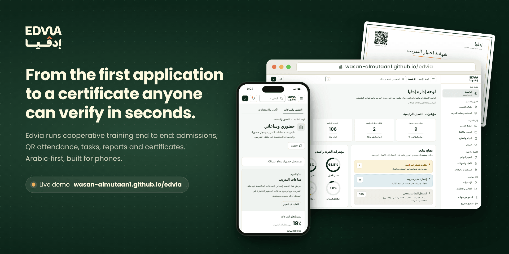
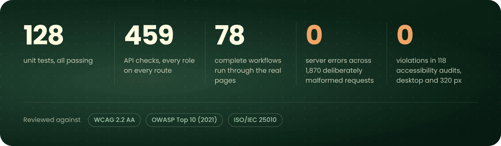
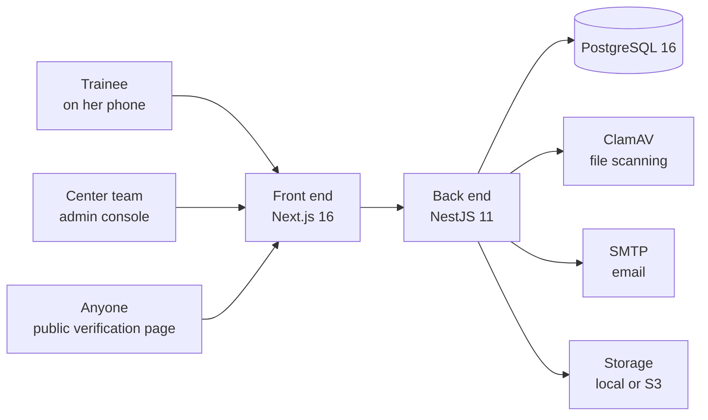
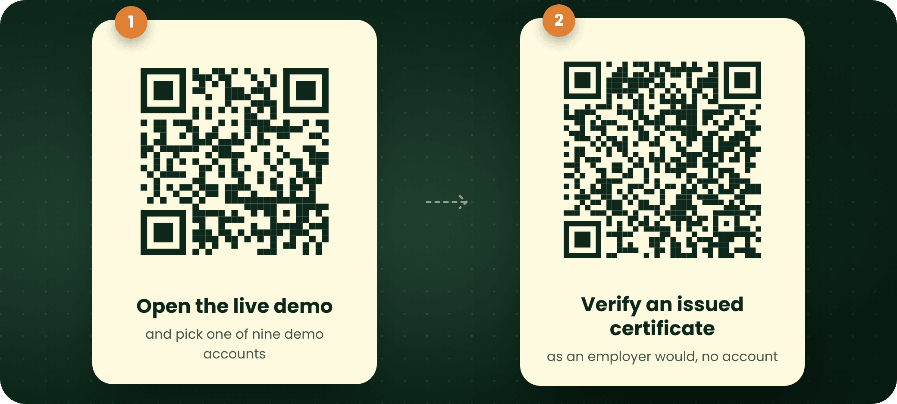

  

  
  &nbsp;
  

Runs in the browser on demo data, with nine ready accounts covering every role. No sign-up. &nbsp;·&nbsp; <a href="README.md">العربية</a>

 

## The whole journey in 46 seconds

  

## Why Edvia?

Cooperative training is a long journey: an application and its documents, admission and placement in a cohort, weeks of attendance, tasks and reports, and finally a certificate. When that journey lives in spreadsheets, email threads and paper sign-in sheets, the team spends its time collecting and reconciling, and an employer holding a certificate has no quick way to know it is genuine.

Edvia puts the whole journey in one platform, with a screen for everyone involved: trainees on their phones, the training center's team in the admin console, and anyone else on a public verification page.

| Instead of | In Edvia |
| --- | --- |
| A paper sign-in sheet typed up by hand | A QR code the trainee scans with her phone, adding the session's hours to her record |
| Tasks sent by email and lost in threads | Submission inside the platform, with review, approval and a history of every version |
| A PDF certificate nobody can check | A certificate with a number and a QR code anyone can verify, no account needed |
| Reports compiled by hand at the end of term | Nine report types, exported as CSV, Excel or PDF |

The product is Arabic-first and right-to-left, so the screens below are in Arabic.

## A day in Edvia

**09:00, the trainer opens today's session and generates its attendance QR code.** The code belongs to the session and expires, and the same sign-in link is shown for anyone without a camera.

**09:03, the trainee scans it with her phone's camera.** The platform opens, her attendance is recorded, and the session's hours appear in her training record.

**13:30, she submits this week's task** with a note and an attachment, after a confirmation explaining that a final submission goes to review. **At 15:10 her supervisor approves it** from the task page, and the trainee sees it marked as approved.

**At the end of the program, the certificates officer issues the certificate** once eligibility is confirmed: an Arabic PDF with a document number and a QR check code.

**Any time after that, an employer scans the code** and lands on the public verification page, which shows the certificate's status and key details without signing in.

**Throughout, management sees the whole picture:** admission, attendance and eligibility indicators, what needs attention today, and reports in one click.

## A space for every role

| Role | What she does in the platform |
| --- | --- |
| Trainee | Applies and uploads documents, checks in by QR, submits tasks and weekly reports, sends excuses, fills in workshop surveys, follows her hours, and downloads her certificate and official documents |
| Admissions officer | Reviews applications and documents, accepts them or returns them for updates, and places accepted trainees in cohorts and groups |
| Training supervisor | Publishes tasks and reviews submissions, follows weekly reports and excuses, and records the confidential final evaluation for the academic supervisor |
| Trainer | Opens attendance sessions and generates QR codes, and runs workshops with their Blackboard links and surveys |
| Certificates officer | Checks eligibility, issues certificates, statements and official documents, and revokes them when needed |
| Director | Follows the dashboard and reports, manages accounts and permissions, and reviews the activity log |
| Anyone | Verifies any certificate or statement by its number or QR code, without an account |

Plus: in-app and email notifications, scheduled notifications and reports, a virus scan on every uploaded file before it becomes available, an audit trail of staff actions, and print and export wherever a page needs them.

## More screens

## Quality you can measure

Before delivery, the platform was tested against a real PostgreSQL database and its actual server, every page was opened in a browser under every role, and the full test run was repeated from scratch after the fixes.

Test details

 

| Check | Result |
| --- | --- |
| Unit tests | 128 of 128 |
| API checks across every role | 459 of 459, in 11 suites |
| Reads by every account on every route | 1,351 of 1,351, none slower than two seconds |
| Deliberately malformed requests | 1,870 requests on 85 routes, no server errors |
| Complete browser workflows | 78 of 78 |
| Page visits and button clicks | 261 visits and 483 clicks, no crashes or server errors |
| Export files | 27 valid files with Arabic headings: CSV, Excel and PDF for every report type |
| Accessibility (WCAG 2.2 AA) | 118 audits at desktop width and 320 px, no violations in the criteria checked |
| Security | Reviewed item by item against the OWASP Top 10 (2021) |
| Software quality | Assessed against the ISO/IEC 25010 characteristics |

## Under the hood

| Layer | Technology |
| --- | --- |
| Front end | Next.js 16, React 19, Tailwind CSS 4 and TypeScript, with a right-to-left Arabic interface |
| Back end | NestJS 11, Prisma 6, JWT authentication, bcrypt hashing, Swagger docs in development |
| Data | PostgreSQL 16, with 44 data models and 29 migrations |
| Documents and files | Arabic PDFs with pdfkit, Excel with exceljs, QR codes, ClamAV virus scanning, local or S3 storage |
| Email and background jobs | SMTP with STARTTLS, and a background scheduler for notifications and reports |
| Operations | Docker Compose, digest-pinned images, and a `/health` endpoint for monitoring |

## Try it now

The live demo serves the platform's real pages and runs entirely in the browser on demo data. Anything you change stays in your browser, and the «نسخة تجريبية» (demo) button at the bottom of the page resets it.

Demo accounts

 

The accounts appear on your first visit. You can also sign in from the login page with any email below and the password `Demo@12345`.

| Account (as shown in the demo) | Email | What to try |
| --- | --- | --- |
| المديرة (director) | `admin@demo.edvia.local` | Every admin section |
| مشرفة التدريب (training supervisor) | `supervisor@demo.edvia.local` | Tasks, weekly reports, excuses |
| مسؤولة القبول (admissions officer) | `admission@demo.edvia.local` | Applications, documents, admission |
| المدربة (trainer) | `trainer@demo.edvia.local` | Attendance and QR, workshops |
| مسؤولة الشهادات (certificates officer) | `certificates@demo.edvia.local` | Eligibility, certificates, statements |
| طالبة في التدريب (trainee in training) | `student01@demo.edvia.local` | Tasks, attendance, weekly reports, excuses |
| طالبة أنهت التدريب (trainee who finished) | `student10@demo.edvia.local` | An issued certificate to download as PDF |
| طالبة قدّمت طلبًا (applicant) | `student12@demo.edvia.local` | An application under review |
| طالبة طلبها يحتاج تحديثًا (application needs an update) | `student14@demo.edvia.local` | Replace a document and resubmit |

Ready-made tours

 

To switch accounts between steps, use the «نسخة تجريبية» button at the bottom of the page, then pick an account card.

1. **QR attendance:** المدربة → الحضور والأعذار → session «يوم تدريبي – الأسبوع 8» → توليد QR. Scan the code with a phone camera and choose «طالبة في التدريب»; the page confirms the check-in.
2. **Submit and approve a task:** طالبة في التدريب → المهام والتقارير → فتح المهمة on «عرض تقديمي عن أبرز ما تعلمته» → note and file → تسليم نهائي. Then مشرفة التدريب → المهام والتقارير → the same task → اعتماد.
3. **Medical excuse:** طالبة في التدريب → الحضور والأعذار → الأعذار والاستئذانات → عذر طبي. Then مشرفة التدريب opens the request and accepts it.
4. **Certificates and verification:** مسؤولة الشهادات → الأهلية والشهادات → إفادة ساعات → إصدار. Then open the new statement's verification link.
5. **Public verification without an account:** home page → التحقق من الشهادة → `DEMO-EDV-2026-0001` → تحقق.
6. **Reports:** المديرة → التقارير والتحليلات → pick a report → CSV, Excel or PDF.

## Privacy and security

- Everything in the live demo is fictional data, and none of it leaves the visitor's browser.
- In the platform itself: role permissions enforced by the server on every route, each trainee's data isolated from the others, hashed passwords, signed download links that expire, and a scan of every file before it is made available.
- The final evaluation is confidential: its details reach authorized staff and the academic supervisor, never the trainee.

## About

Edvia is a project by [@WASAN-ALMUTAAN1](https://github.com/WASAN-ALMUTAAN1), built for a center that runs cooperative training programs for female students. This repository holds the live demo and its media for showcase purposes; the source code belongs to the platform's owner and is not published here.

If you run a training journey like this one, or have a question about the project, I'd be glad to talk: [open a conversation](https://github.com/WASAN-ALMUTAAN1/edvia/issues/new) or reach me through [my GitHub profile](https://github.com/WASAN-ALMUTAAN1).

 

The Edvia name, logo and visual identity belong to the platform's owner. All data shown is fictional, for demonstration only. All rights reserved.

