

  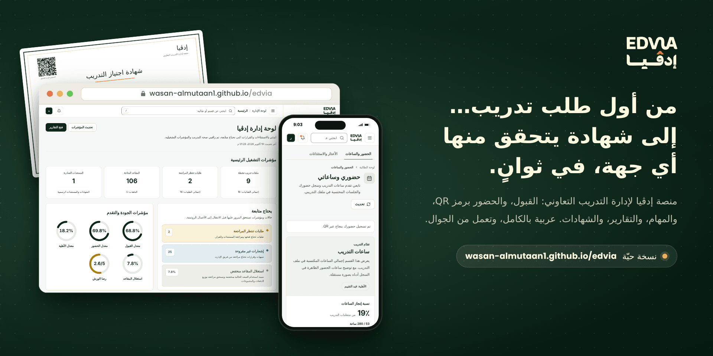

  
  &nbsp;
  

تعمل في المتصفح ببيانات تجريبية، بتسعة حسابات جاهزة لكل الأدوار، دون تسجيل. &nbsp;·&nbsp; <a href="README.en.md">English</a>

 

## الرحلة كاملة في 46 ثانية

  

## لماذا إدڤيا؟

التدريب التعاوني رحلة طويلة: طلب ومستندات، ثم قبول وتوزيع على الدفعات، ثم أسابيع من الحضور والمهام والتقارير، وفي آخرها شهادة. وحين تتوزع هذه الرحلة على جداول ورسائل وأوراق، يذهب وقت الفريق في التجميع والمطابقة، ولا تجد جهة التوظيف طريقة سريعة لتتأكد من شهادة بين يديها.

إدڤيا تجمع الرحلة في منصة واحدة، ولكل طرف شاشته: المتدرّبة من جوالها، وفريق المركز من لوحة الإدارة، وأي جهة من صفحة تحقق عامة.

| بدلًا من | في إدڤيا |
| --- | --- |
| كشف حضور ورقي يُوقَّع ثم يُفرَّغ يدويًا | رمز QR تمسحه المتدرّبة بجوالها، فتُضاف ساعات الجلسة إلى ملفها |
| مهام تصل بالبريد وتضيع بين الرسائل | تسليم داخل المنصة، بمراجعة واعتماد وسجل لكل نسخة |
| شهادة PDF لا يُعرف إن عُدّلت | شهادة برقم ورمز QR، يتحقق منها أي أحد دون حساب |
| تقارير تُجمع يدويًا في آخر الفصل | تسعة أنواع من التقارير، تُصدَّر بصيغ CSV وExcel وPDF |

## يوم في إدڤيا

**09:00، المدرّبة تفتح جلسة اليوم وتولّد رمز الحضور.** الرمز مرتبط بالجلسة وصالح لمدة محددة، ويظهر معه رابط التسجيل نفسه لمن لا تملك كاميرا.

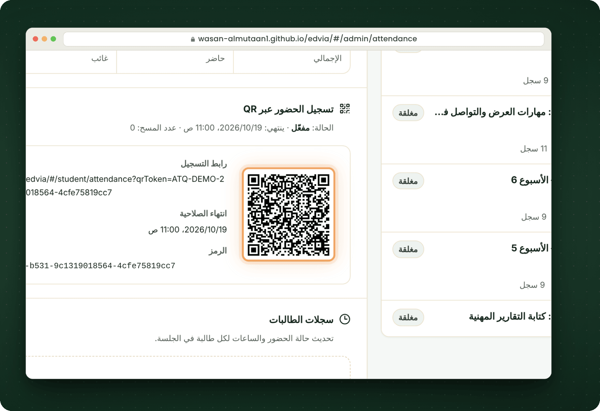

**09:03، المتدرّبة تمسح الرمز بكاميرا جوالها.** يُفتح رابط المنصة، ويُسجَّل حضورها، وتظهر ساعات الجلسة في ملف تدريبها.

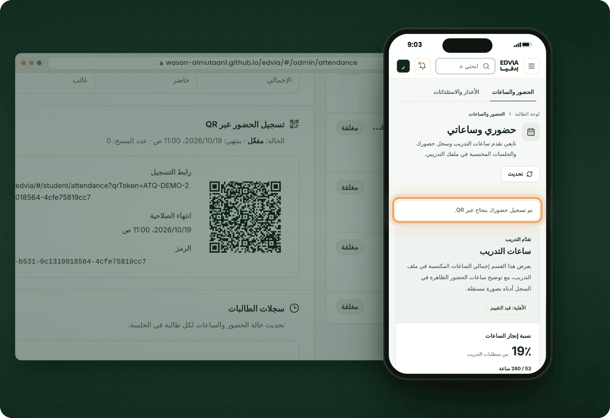

**13:30، تسلّم مهمة الأسبوع** بنص ومرفق، بعد تأكيد يوضح أن التسليم النهائي يذهب إلى المراجعة. **وفي 15:10 تعتمده المشرفة** من صفحة المهمة، فتتغير حالته عند المتدرّبة إلى «معتمد».

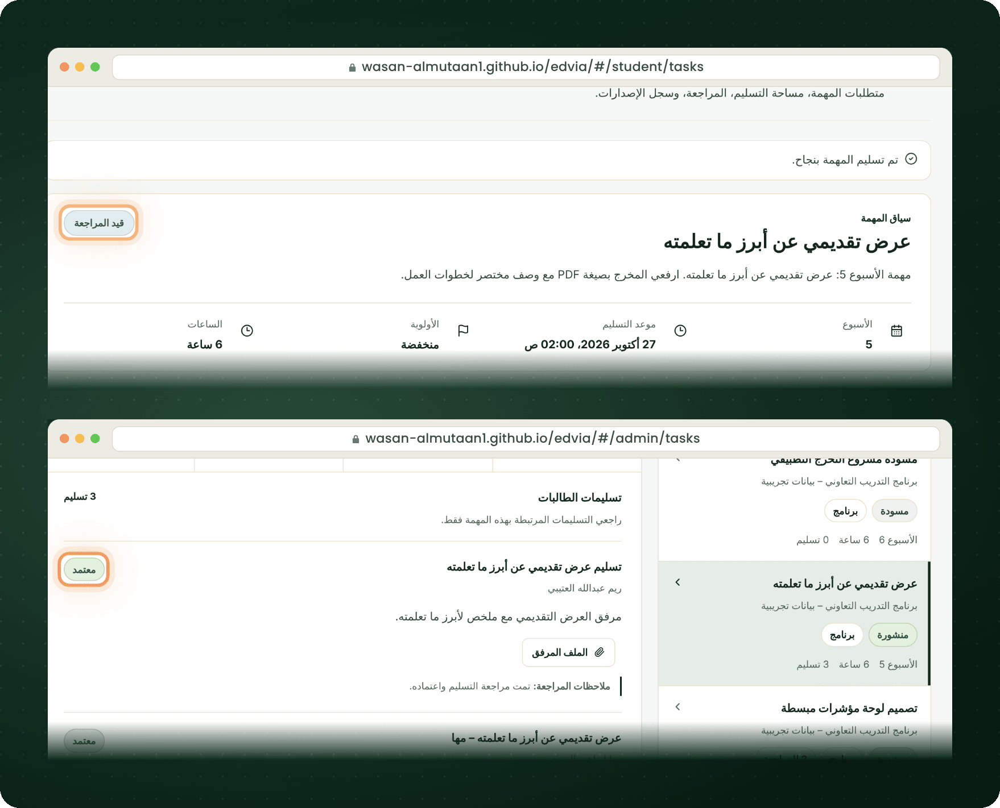

**في نهاية البرنامج، تُصدر مسؤولة الشهادات الشهادة** بعد فحص الأهلية: ملف PDF عربي برقم المستند ورمز QR للتحقق.

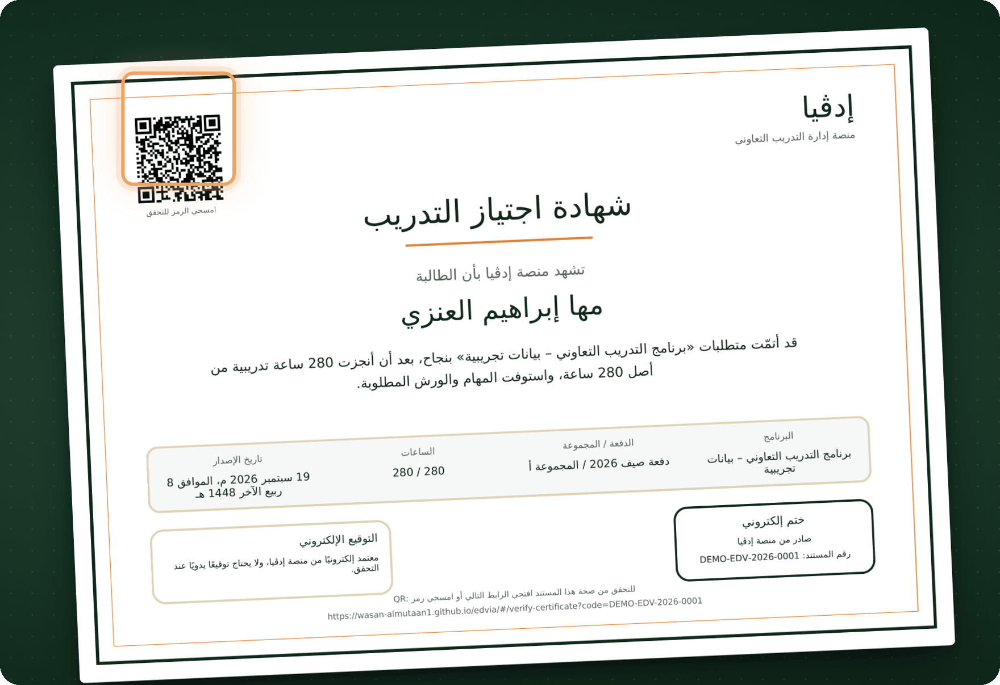

**وفي أي وقت بعدها، تمسح جهة التوظيف الرمز** فتفتح صفحة التحقق العامة، وترى حالة الشهادة وبياناتها الأساسية، دون تسجيل دخول.

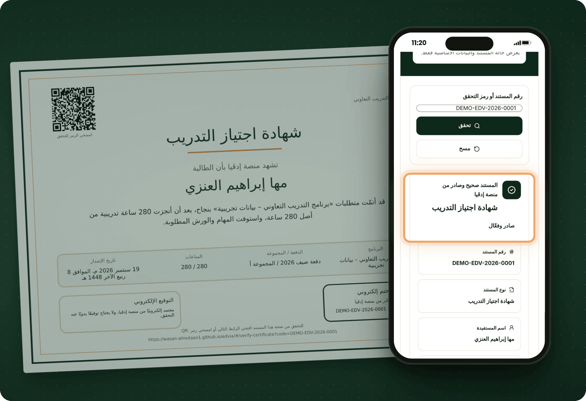

**وطوال البرنامج، ترى الإدارة الصورة كاملة:** مؤشرات القبول والحضور والأهلية، وما يحتاج متابعة اليوم، وتقارير تُصدَّر بنقرة.

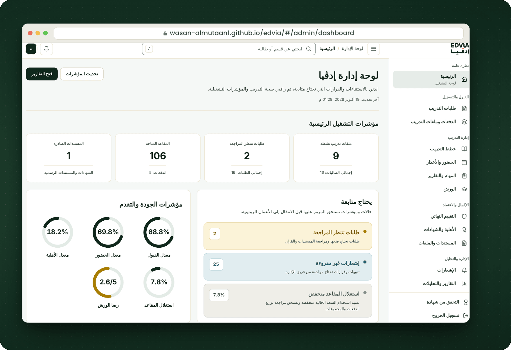

## لكل دور مساحته

| الدور | ما تفعله في المنصة |
| --- | --- |
| المتدرّبة | تقدّم الطلب وترفع مستنداتها، وتسجّل حضورها برمز QR، وتسلّم المهام والتقارير الأسبوعية، وترسل الأعذار، وتعبّئ استبيانات الورش، وتتابع ساعاتها، وتنزّل شهادتها ومستنداتها الرسمية |
| مسؤولة القبول | تراجع الطلبات والمستندات، وتقبل الطلب أو تعيده للتحديث، وتوزّع المقبولات على الدفعات والمجموعات |
| مشرفة التدريب | تنشر المهام وتراجع التسليمات، وتتابع التقارير الأسبوعية والأعذار، وتسجّل التقييم النهائي السري وترسله للمشرفة الأكاديمية |
| المدرّبة | تفتح جلسات الحضور وتولّد رموز QR، وتدير الورش وروابطها على Blackboard واستبياناتها |
| مسؤولة الشهادات | تفحص الأهلية، وتُصدر الشهادات والإفادات والمستندات الرسمية، وتلغيها عند الحاجة |
| المديرة | تتابع لوحة المؤشرات والتقارير، وتدير الحسابات والصلاحيات، وتراجع سجل النشاط |
| أي جهة | تتحقق من أي شهادة أو إفادة برقمها أو برمز QR، دون حساب |

ومعها: إشعارات داخل المنصة وبالبريد، وإشعارات وتقارير مجدولة، وفحص كل ملف مرفوع من الفيروسات قبل إتاحته، وسجل تدقيق لإجراءات الموظفين، وطباعة وتصدير في كل صفحة تحتاجهما.

## مزيد من الشاشات

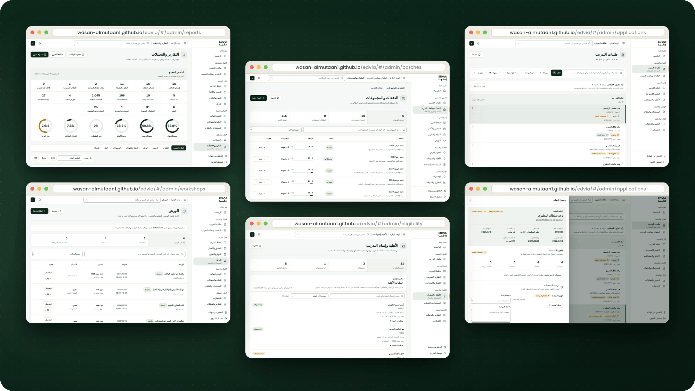

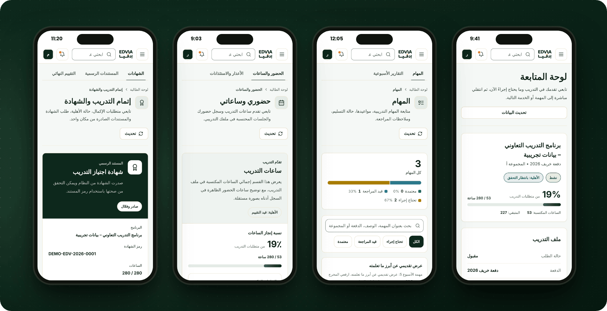

## جودة يمكن قياسها

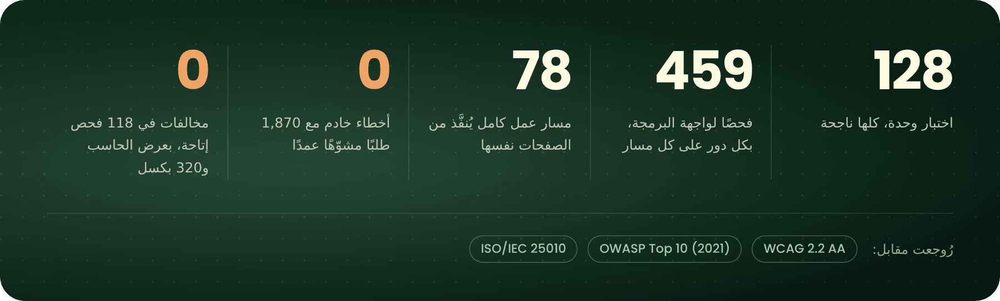

قبل التسليم، فُحصت المنصة على قاعدة بيانات PostgreSQL حقيقية وخادمها الفعلي، وفُتحت كل صفحة بكل دور في المتصفح، ثم أُعيدت الفحوص كلها من البداية بعد الإصلاحات.

تفاصيل الفحص

 

| الفحص | النتيجة |
| --- | --- |
| اختبارات الوحدة | 128 من 128 |
| فحوص واجهة البرمجة بكل الأدوار | 459 من 459، في 11 مجموعة |
| طلبات القراءة بكل حساب على كل مسار | 1,351 من 1,351، ولا طلب أبطأ من ثانيتين |
| طلبات مشوّهة عمدًا | 1,870 طلبًا على 85 مسارًا، دون أي خطأ خادم |
| مسارات عمل كاملة في المتصفح | 78 من 78 |
| زيارة الصفحات والنقر على الأزرار | 261 زيارة و483 نقرة، دون أعطال أو أخطاء خادم |
| ملفات التصدير | 27 ملفًا صالحًا بعناوين عربية: CSV وExcel وPDF لكل نوع تقرير |
| الإتاحة (WCAG 2.2 AA) | 118 فحصًا بعرض الحاسب و320 بكسل، دون مخالفات في المعايير المفحوصة |
| الأمان | مراجعة بندًا بندًا مقابل OWASP Top 10 (2021) |
| جودة البرمجيات | تقييم مقابل خصائص ISO/IEC 25010 |

## من الداخل

| الطبقة | التقنيات |
| --- | --- |
| الواجهة | Next.js 16، وReact 19، وTailwind CSS 4، وTypeScript، بواجهة عربية من اليمين إلى اليسار |
| الخادم | NestJS 11، وPrisma 6، ومصادقة JWT، وتشفير bcrypt، وتوثيق Swagger أثناء التطوير |
| البيانات | PostgreSQL 16، في 44 نموذج بيانات و29 ترحيلًا |
| المستندات والملفات | PDF عربي بمكتبة pdfkit، وExcel بمكتبة exceljs، ورموز QR، وفحص الفيروسات بـClamAV، وتخزين محلي أو S3 |
| البريد والمهام الخلفية | SMTP مع STARTTLS، ومجدول في الخلفية للإشعارات والتقارير |
| التشغيل | Docker Compose، وصور مثبتة ببصمتها، ومسار `/health` للمراقبة |

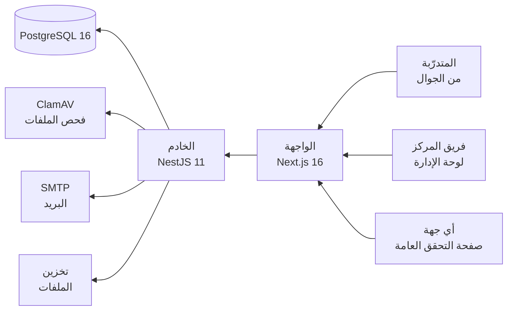

## جرّبها الآن

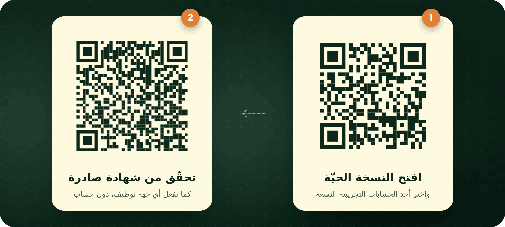

النسخة الحيّة تعرض صفحات المنصة الفعلية نفسها، وتعمل كاملة داخل المتصفح ببيانات تجريبية. أي تغيير تجرونه يبقى في متصفحكم، ويمكن إعادته إلى أصله من زر «نسخة تجريبية» أسفل الصفحة.

الحسابات التجريبية

 

تظهر الحسابات في أول زيارة. ويمكن الدخول أيضًا من صفحة تسجيل الدخول بأي بريد أدناه، وكلمة المرور `Demo@12345`.

| الحساب | البريد | ما يمكن تجربته |
| --- | --- | --- |
| المديرة | `admin@demo.edvia.local` | كل أقسام الإدارة |
| مشرفة التدريب | `supervisor@demo.edvia.local` | المهام، والتقارير الأسبوعية، والأعذار |
| مسؤولة القبول | `admission@demo.edvia.local` | طلبات التدريب، والمستندات، والقبول |
| المدربة | `trainer@demo.edvia.local` | الحضور ورمز QR، والورش |
| مسؤولة الشهادات | `certificates@demo.edvia.local` | الأهلية، والشهادات، والإفادات |
| طالبة في التدريب | `student01@demo.edvia.local` | المهام، والحضور، والتقارير الأسبوعية، والأعذار |
| طالبة أنهت التدريب | `student10@demo.edvia.local` | شهادة صادرة تُنزَّل بصيغة PDF |
| طالبة قدّمت طلبًا | `student12@demo.edvia.local` | طلب تدريب قيد المراجعة |
| طالبة طلبها يحتاج تحديثًا | `student14@demo.edvia.local` | رفع مستند بديل، ثم إعادة إرسال الطلب |

جولات جاهزة للعرض

 

لتبديل الحساب بين الخطوات: زر «نسخة تجريبية» أسفل الصفحة، ثم بطاقة الحساب.

1. **الحضور برمز QR:** «المدربة» ← «الحضور والأعذار» ← جلسة «يوم تدريبي – الأسبوع 8» ← «توليد QR». امسحوا الرمز بكاميرا الجوال واختاروا «طالبة في التدريب»، فتظهر «تم تسجيل حضورك بنجاح عبر QR».
2. **تسليم مهمة واعتمادها:** «طالبة في التدريب» ← «المهام والتقارير» ← «فتح المهمة» على «عرض تقديمي عن أبرز ما تعلمته» ← نص وملف ← «تسليم نهائي». ثم «مشرفة التدريب» ← «المهام والتقارير» ← المهمة نفسها ← «اعتماد».
3. **عذر طبي:** «طالبة في التدريب» ← «الحضور والأعذار» ← «الأعذار والاستئذانات» ← «عذر طبي». ثم «مشرفة التدريب» تفتح الطلب وتقبله.
4. **الشهادات والتحقق:** «مسؤولة الشهادات» ← «الأهلية والشهادات» ← «إفادة ساعات» ← «إصدار». ثم افتحوا رابط التحقق من الإفادة الجديدة.
5. **التحقق العام دون حساب:** الصفحة الرئيسية ← «التحقق من الشهادة» ← `DEMO-EDV-2026-0001` ← «تحقق».
6. **التقارير:** «المديرة» ← «التقارير والتحليلات» ← اختيار التقرير ← CSV أو Excel أو PDF.

## الخصوصية والأمان

- كل ما في النسخة الحيّة بيانات وهمية، ولا يغادر شيء منها متصفح الزائر.
- في المنصة نفسها: صلاحيات لكل دور يفرضها الخادم على كل مسار، وبيانات كل متدرّبة معزولة عن غيرها، وكلمات مرور مشفرة، وروابط تنزيل موقّعة ومحدودة المدة، وفحص لكل ملف قبل إتاحته.
- التقييم النهائي سري: تفاصيله تصل الموظفين المخوّلين والمشرفة الأكاديمية، ولا تصل المتدرّبة أبدًا.

## عن المشروع

إدڤيا من أعمال [WASAN-ALMUTAAN1](https://github.com/WASAN-ALMUTAAN1)، طُوّرت لمركز يدير برامج التدريب التعاوني للطالبات. يضم هذا المستودع النسخة الحيّة وصورها للعرض، أما الشيفرة المصدرية فخاصة بالجهة صاحبة المنصة.

إن كانت لديكم رحلة تدريب تشبه هذه، أو سؤال عن المشروع، فيسعدني الحديث عنها: افتحوا [محادثة جديدة](https://github.com/WASAN-ALMUTAAN1/edvia/issues/new) أو تواصلوا عبر [ملفي على GitHub](https://github.com/WASAN-ALMUTAAN1).

 

اسم إدڤيا وشعارها وهويتها البصرية ملك للجهة صاحبة المنصة. كل البيانات المعروضة وهمية لأغراض العرض. جميع الحقوق محفوظة.

